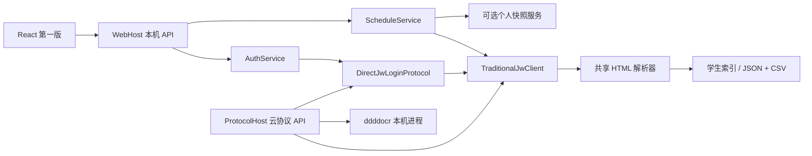

# 后端技术手册与 Agent 接手入口

## 2026-10-17 V1.0.0 自动更新增量

用户最新授权检查/自动下载/安装更新，当前实现以Core/Releases＋Velopack1.2.161为准，公开来源Gust-feng/XKE，稳定win渠道与PackageId=XKE；不恢复旧Updater/云控制。新机器设置auto_update_enabled与原生受控/api/app/updates状态/检查/下载/安装入口已接入。HTTP下载仅排队，C#持有并在关闭时排空；校验后退出应用，不强退到托盘的软件。关闭自动更新不会自动安装本地已下载包。

REL-02内容门禁、REL-03 runtime8.0.32发布基线已在新打包流程实现，78份合成门禁验证通过；REL-01自助摘要配置是可选非敏感注入，不再作为纯连接功能的发布前提。详细协议、已验证/待验收边界与公开发布授权要求见08_release_and_updates.md及任务板最新记录；旧“所有更新退役”与旧打包问题保留历史语境。

## 2026-10-16：桌面安全入口、提醒与课表后台闭环

- LocalApiAccessPolicy在CORS之前校验Host/Origin；默认实际同源，独立WebHost通过XKE_FRONTEND_ORIGINS分号分隔配置开发来源，不把任意本机端口当可信。ProtocolHost不套此本机边界。desktop-webview的auth-bootstrap、desktop/settings由原生X-XKE-Desktop随机能力保护，WebHostService逐项传递options；MainWindow仅给本应用API注入，不在JS/URL/磁盘保存。原生bridge和主导航也校验实际来源。此机制不防同用户原生恶意程序读取该用户数据。
- LessonReminderScheduler与网络/课表各自串行循环并行；IDesktopNotifier由WindowsDesktopNotifier在WPF dispatcher调用既有托盘通知。窗口隐藏或静默启动无WebView时仍可提醒；独立HTTP宿主Noop不发通知。默认分钟30，正数最短15，选项关闭/15/30/45，自定义合法值保留且不开启既有关闭项。
- 提醒只用当前学期本地已知日期、周与时间；更新的周（含空周）覆盖旧整学期，未知日历/时间不猜。相同课程/教师/已知教室的相邻短课间仅提醒一次，跨午夜提前时间可用；实际原生展示前再次复核账号、设置与2分钟有效窗口，休眠不补过期提醒。去重回执位于students/<student_id>/info/lesson_reminders.json，仅日期及不可逆指纹，普通业务JSON、原子写入并裁剪历史，不存课程正文、凭据或会话；进程重启仍去重。平台接受通知不等于用户在免打扰下实际看见。
- ScheduleService后台入口逐步校验活动会话与自动刷新配置，NativeJwScheduleClient续跑/恢复保存前执行同一复核；409取消不污染job错误/成功。手动仍走原入口。React每30秒仅观察可见job，成功后只读本地周/整学期并按新鲜度合并，保留历史浏览；逻辑取消+排空批次不是fetch传输级取消。
- DesktopSingleInstance的命名互斥在首次await之前获取；次实例最多等待15秒唤窗。MainWindow退出保持dispatcher存活等待host停止，延迟Close避免同步重入；App在拥有线程释放互斥。验证和当前待办统一见任务板APP-01～05。

## 2026-10-16：现有网络策略的可靠性修正（当前实现）

保留门户可达且外网不通时重认证；不新增真正续租接口，不恢复用户已取消的会话寿命实验。NetworkService区分MaintainAsync与MaintainInBackgroundAsync，后者校验后台开关及宿主活动会话；在发送密码及重试前后验证当前会话/配置/凭据，避免旧任务越过注销或配置更改边界。手动连接不因保活关闭被禁止，已发请求不能撤回。

外网探测拒绝已识别认证表单、异常重定向/异源及代理认证，但保留普通目标4xx的可达性，不把403/404当作必须重登录。认证后的最终快照统一决定状态/错误/历史，不再双重检测后假报成功。

生产NetworkHttpTransport已显式禁用系统HTTP代理及自动重定向；本节覆盖下方历史“尚未禁用代理”的核对说明。不会覆盖OS路由或Mihomo/TUN。后台网络和课表循环独立，配置/凭据修订在下一次网络检查提前触发；凭据轮询只取文件元数据，未解密或记录密码。详细修复边界/测试见任务板NET-01～06，69项定向通过，无UI/DTO结构变化。


## 2026-10-16：获批暂停自动维护后的实验准备（未开始寿命计时）

用户同意暂时停止自动重认证并允许自然掉线，另开手机共享网络保障API。通过本项目本机API仅将当前账号heartbeat_enabled从true改为false，并确认后台enabled=false、next_run_at=null；未改账号密码、IP、网卡、默认路由或Mihomo设置。

基线干扰：本机同时有有线校园网、手机USB共享与Mihomo虚拟路由；默认物理出口已优先手机共享，常规门户请求不能代表校园网线路。浏览器插件的新读取没有完成，因此旧的成功登录页不能作为新基线。另用独立只读探针对单个socket绑定有线网卡（非全局改路由），不带Cookie、不开代理、不执行响应脚本、不自动跟随重定向，取得HTTP200登录页；未得到可确认的在线会话。此结果不足以判定是原会话失效还是源地址/页面识别条件差异，更不能据此计算刚刚过期时间。

实验没有进入quiet-start，未开始后台监控。已把heartbeat_enabled恢复原true，并读回确认后台enabled=true；所有探针进程均为单次运行后退出。没有发起认证、注销或切换IP，没有复制真实账号、Cookie、页面正文或服务器IP到代码/测试。中性探针源码仅位于ignored artifacts/campus-session-experiment，门户由运行时环境变量传入；没有真实端点常量。

若继续，需要用户明确同意经校园网接口向原门户提交一次已保存凭据，取得有确定成功起点的会话；随后才能关自动重认证并开始计时。没有基线时不应把“页面还开着”或“热点外网可达”冒充校园网存活证据。一天的本地缓存与NAS会话期限仍只是相关性假设。


## 2026-10-16：认证寿命与浏览器缓存期限进一步核对

- 当前门户仍显示成功登录，但它是静态展示，不以其持续可见推断NAS认证会话持续存活。本轮另一个193秒计时观察窗未捕获HTTP请求或WebSocket帧，未截断；与此前69秒为两个窗口，不合并宣称连续长测。访客/扫码计时器仍未运行。
- 当前配置storeExpireTime=86400，a41.js注明认证数据缓存时长、默认1天；a40.js的cookie封装实际通过store保存val/exp/time，并在读取时检查过期。因此该值是浏览器本地认证资料缓存期限，不是网关在线会话24小时TTL，也不是客户端每24小时续期。未读取缓存中的账号/密码或Cookie值。
- 页面出现time/oltime/stime/etime字段，但未确认它们能作为当前会话的剩余时长或失效截止点，不输出真实时间值，也不将未知大数解释成永久在线。已加载页面与配置未找到明确最大会话时长/空闲超时；不代表服务器没有相关策略。
- 真实寿命仍待验证：固定会话时限、空闲超时、网络环境变化应分开测试。普通网页、后台软件和XKE自动重连会干扰；持续探测可能刷新空闲计时。需要先获用户许可停止被测设备自动重认证，并确认允许自然掉线，或用专门测试设备/不改变会话的独立观测点。不能在用户持续使用当前设备、自动重连仍可能存在时宣称测出寿命。
- 本轮仅浏览器插件只读分析和被动监听；已关闭调试，未重认证/注销/修改IP/关闭软件保活，也未开始后台长期监控。生产代码与UI无变化。


## 2026-10-16：用户已登录门户的浏览器只读观察

用户明确授权通过Chrome插件分析当前校园网门户，未要求执行认证/注销或修改IP。只观察该门户标签，未访问其余浏览内容，未重放认证、注销、切设备、改静态IP；调试Network/Debugger已关闭，结束时页面仍显示成功登录。以下仅保留脱敏结构，不保存原页面/脚本、账号、Cookie、IP/MAC值或完整请求参数。

### 已观察事实

- 当前页面为成功登录的pc_1模板，login_method=0、registerMode=1、onlineMonitor开启。pc_1资源是模板，未包含周期认证/续期定时调用。
- 明确计时观察窗69秒内，没有新增HTTP或WebSocket事件，捕获未截断。访客检查page.timer与二维码qrCode.timer均未运行。该结果只证明当前页面/观察窗，不证明服务端永不超时或网关没有自身计时。
- 共享a40.js中的qrCode.startKeepAlive每5秒检查online_list或特定状态页面，用来等待扫码终端上线；成功后停止并跳转，不是已登录会话续租。a41.js中8秒checkUserStatusAndLoginByIP用于访客审核/上线流程；当前非该分支，不应仅凭名称当作普遍保活。
- 当前普通登录构造/drcom/login，使用DDDDD/upass/0MKKey及终端、协议控制参数；default_login及JSONP封装没有显式添加wlan_user_ip/wlan_user_mac（有v6ip字段）。其他门户流程存在IP/MAC/网关字段，不能混淆各分支。未重放此登录请求。
- 共享脚本还出现/eportal/portal/online_list及/eportal/portal/page/loadUserInfo，前者被扫码状态监控使用，后者获取用户资料。本轮未调用它们，响应结构、权限、是否能作为本终端认证判据仍未验收；资料可读不等于网关放行，不能直接接为心跳接口。

### 对实现方向的约束

当前证据更符合“网关维护认证会话、浏览器在线页无需持续提交密码”，但不能证明服务器只按IPv4鉴权；同IP跨设备免登录、MAC/接入口绑定、空闲/最大会话时限均未验证。不得通过复用他人IP或伪造静态地址来实现维持在线。

优先研究权威的终端在线状态，分离认证失效与外网故障，网络变化后重核验，明确失效才走凭据重认证；没有经验证的续期要求，不凭空加重复登录或所谓心跳。不将自助后台Cookie、扫码等待轮询、HTTP连接复用误当上网会话续期。NET-01～06可靠性问题仍待修，不因本次网页观察而视为解决。


## 保活审查补充：代理说明更正（当前代码事实）

下方历史记录中的“门户请求和联网检查直连、不使用系统HTTP代理”不符合当前实现：XkeWebHostApplication默认装配new HttpClient()，未显式禁用代理；不能据此保证校园网检测和认证避开系统代理。该项归入NET-04待修，实际是否使用代理取决于系统及环境配置。其余系统路由/VPN、服务器IP授权边界不变。本轮仅核对，无真实认证或网络设置修改。完整保活可靠性问题见notes/review-issues/00_current_issues.md的NET-01～06。

## 2026-10-15：课表日期与课程新鲜度解耦

注销重登可能拿到日期为空但课程更新的单周结果，不能用新鲜度直接抹掉同学期日历。XkeScheduleStore.FindSemesterStartDate按明确学生/academic_term/来源从有效缓存周一与周号恢复学期起点；ScheduleService在本地响应及新结果持久化前只补缺失week_dates，来源已给日期优先、课程/更新时间不回滚，空学期/其他账号/历史学期不互借，真实缺日期仍保持未知，不推断今天。前端合并独立选择日历与目录；细节和验证见本项目任务板。

## 2026-10-15：四种接入方式凭据与可配置心跳

- 校园网/电信/联通/移动都在连接设置显示“账号”“密码”，各自保存到当前学生的DPAPI网络凭据文件，不自动复制或转发教务密码。校园网未独立配置时明确提示，教务工作区与登录资料不修改。
- 自动保持连接的心跳间隔在同一编辑器设置，1～1440分钟整数；后台C#按配置检查、必要时重认证，不依赖前端定时认证。更改配置不等于服务器已经认证成功。
- 认证JSON/JSONP按result/msg/ret_code提取结果，只解析数据、不执行脚本；operation_error独立于internet_connected，另一条链路有外网不代表此次认证通过。IP权限文本、认证拒绝、响应异常、服务错误/超时分别保留必要原因，不回显原始响应或未脱敏凭据；只有服务器明确提供的信息才用于归类，不猜测允许网段或错误码含义。
- 门户请求和联网检查直连、不使用系统HTTP代理；系统路由/VPN和服务器IP授权仍可能影响结果。不能靠改网卡/伪造IP绕过限制，手动IP功能保持删除。

## 2026-10-15：校园网只读IP与配置边界

手动IP能力已按用户要求移除。GET/POST /api/network/config仅管理接入方式、门户/检测地址、保活和运营商凭据，不再返回apply_result或静态IP/子网/网关/DNS配置，NetworkService不再运行netsh。IP继续从network/status.interface.ipv4显示；本机网卡采集保留已修复的OEM命令解码。旧业务不迁移，删除功能不代表修改系统网卡或恢复DHCP。


更新：2026-10-13。项目全程处于开发状态，从未投入使用；不支持旧业务文件迁移或双格式读取。
用户已锚定产品第一版，源码设计来源为第七版「合成」。界面样式和动效以 `frontend/` 为唯一基线。

课表显示偏好ui.inactive_course_mode当前默认dim，历史的默认hide记录已覆盖。hide只隐藏当前周已结束课程，历史周始终可回看；这是显示规则，不影响课表采集、缓存及覆盖。

前端当前按服务器入学日期筛选个人学期目录，简短学期与刷新收在左栏学期尺；时间轴优先使用服务器block_times，缺少时使用已加载学期的真实课程范围，完整学期裁尾部空周。内部semesterLoaded表示全学期覆盖，scope仍表示所选周来源，不是后端DTO新字段。校园网连接前后同一布局，页面可见期间每30秒只读status，不在前端调度保活；无能力统计不做空占位。详细规则和当前桌面加载状态见前端交接及任务板。

连堂合并属于前端按目标周计算的显示模型：course-blocks.ts生成CourseBlock，parts保留全部原课时，moveFrom仅表示相邻换教室。后端仍保存原始规范化周/学期与精确分段，不在API或JSON/CSV增加这些字段；新单周覆盖先于显示聚合。不同周规则只在共同出现周聚合显示，换教室/重叠/不同教师不得误合；课间倒计时保留真实休息。未来提醒/导出应基于原课时，不把合并显示跨度当成连续授课时间。

本轮用户确认既有学校表单登录协议此前实测可用；`DirectJwLoginProtocol` 与已提交登录基线无差异，继续复用，不重新研究协议。新增OCR/宿主组合的验证与历史协议可用性分开记录。

2026-10-14 校园网自助后台已实现独立 `CampusSelfServiceClient` / `CampusSelfServiceSummaryService`，经 `GET /api/network/summary` 返回账号状态、套餐、计费方式及服务器周期原文；与认证门户 `NetworkService` 和 JW 分离，不接保活/status调度。真实HTTP登录、五字段及会话复用已通过；前端/桌面加载由主线程验收。协议、白名单和私有配置详见 [07_self_service_protocol.md](07_self_service_protocol.md)。

自助后台配置为 `CampusSelfServiceOptions`：显式 `XKE_CAMPUS_SELF_SERVICE_CONFIG` → 可执行目录 `xke.campus-self-service.json` → ignored开发目录 `开发数据/校园网/self-service.local.json`。只含endpoint及timeout_seconds，不含密码；使用已有受控校园凭据。成功摘要内存缓存5分钟，账号/密码变化失效，失败保留旧摘要但允许立即重试。新接口不是用户上网状态，且不持久化自助Cookie或原始页面。本机私有配置已由主线程落盘，桌面已重启、summary五字段和缓存复读已确认；当前打包工具尚无此配置自动注入，发布须显式提供文件或环境变量。

## 十分钟接手

1. 阅读根 `AGENTS.md`，确认共同工作区、写集和敏感资料边界。
2. 阅读本手册、[API 契约](03_api_contract.md)和[协议服务部署](06_protocol_host.md)。
3. 阅读项目四份状态文档；历史 Vue、移动教务、选课、云同步记录不作为现行要求。
4. 查看 `git status --short`、当前工作区与暂存区 diff。已有大量并行变更，不执行 reset/clean，不全仓库暂存。
5. 按下面的入口定位真实代码，跑受影响测试。不要把构建成功、假服务验证或 Cookie 数据提取当作真实登录/发布验收。

## 工程和数据流

| 入口 | 职责 |
| --- | --- |
| `src/Xke.Contracts/` | HTTP 请求、响应、资料与设置模型；字段以 JsonPropertyName 为准 |
| `src/Xke.Core/Auth/AuthService.cs` | 桌面账号、本地恢复、验证码 challenge、初始化与回滚 |
| `src/Xke.Core/Auth/Jw/DirectJwLoginProtocol.cs` | 默认学校表单登录，独立 CookieContainer，纯 HTTP |
| `src/Xke.Core/Schedule/TraditionalJwClient.cs` | 已登录资料、单周/学期 GET；同时保留旧 SSO 代码 |
| `JwStudentProfileParser.cs`、`TraditionalJwScheduleHtmlParser.cs` | AngleSharp DOM 解析，不联网、不执行 JS |
| `ScheduleService.cs` | 桌面统一课表模型、个人快照服务优先/直接 JW 回退、串行刷新与落盘 |
| `ScheduleDataMapper.cs` | 两种宿主共用周/学期转换、完整安排去重、时间和元数据规则 |
| `ProtocolScheduleApiClient.cs` | 本机读取已经登录的协议服务，仅GET，不向云服务发送学校密码 |
| `src/Xke.Storage/` | 按学生/学期/周保存资料与课表 |
| `src/Xke.Security/` | Windows 凭据、Cookie、会话等现有 DPAPI 边界 |
| `src/Xke.WebHost/` | 本机 API、后台课表刷新/校园网保活与前端资源 |
| `src/Xke.DesktopHost/` | WPF/WebView2、托盘、自启动、窗口生命周期 |
| `src/Xke.ProtocolHost/` | 云服务器协议 API；复用 Core/Storage，学校登录材料只在内存 |
| `frontend/src/api/` | React HTTP/视图模型适配；preview 数据与 runtime 分开 |
| `tools/ocr/` | ddddocr CPU 识别进程，只接收验证码图片 |



桌面与云服务共享协议和数据规则，宿主生命周期独立。云服务不装配校园网、本机启动项或 WPF。

## 登录方案：先区分四种状态

| 状态 | 含义 | 使用位置 |
| --- | --- | --- |
| 学校 Cookie | 学校服务器会话，依赖 Host/Path | TraditionalJwClient 内部 |
| 应用 session_id | 桌面应用自己的 API 会话 | 前端内存、X-XKE-Session 请求头 |
| trusted_login_token | 本机已建立工作区的恢复材料 | C# 本机存储，前端不持久化 |
| challenge_id | 一次验证码与对应 HTTP 会话 | 短时内存；登录和课表续跑分开 |

学校响应通常是 HTML，当前 Cookie 协议不能当作 JWT 接口。旧移动 token 不参与默认登录。
普通浏览器的 localStorage/sessionStorage 不保存密码、session 或 trusted token。

### 学校表单协议（默认）

`DirectJwLoginProtocol` 持有一个独立 HttpClient/CookieContainer。验证码、随机编码材料和登录提交必须属于同一会话：

| 顺序 | 请求（Host 使用源码当前固定学校入口） | 作用 |
| --- | --- | --- |
| 1 | GET `<FORM_LOGIN_HOST>/` | 建立会话与重定向上下文 |
| 2 | GET `/verifycode.servlet?t=<NONCE>` | 取得图片；桌面交给用户，协议服务交给 ddddocr |
| 3 | POST `/Logon.do?method=logon&flag=sess` | 获取 `padding#indexes` 编码材料 |
| 4 | POST `/Logon.do?method=logon` | form 字段 `RANDOMCODE`、`encoded`；跟随重定向 |
| 5 | GET `<JW_HOST>/jsxsd/grxx/xsxx` | 用实际资料响应确认进入个人工作区 |
| 6 | GET 首页周目录和课表 | 初始化或刷新规范化业务文件 |

`encoded` 由 `user + "%%%" + password` 和服务器 padding/indexes 交错生成，详见 `EncodeCredentials`。
这是学校协议编码，不是项目自行设计的密码加密。登录需要两个 POST；资料/课表获取保持 GET，不能把“所有请求均 GET”写成完整登录承诺。
User-Agent 虽包含浏览器标识，运行过程没有浏览器环境。

`CompleteAsync` 检查重定向进入 `/jsxsd/`；后续资料/课表仍须检查返回登录页或 `flag1=2`。
登录后的 HttpClient 所有权转交 `TraditionalJwClient`，不能提前 Dispose。
Cookie 按 Name+Host+Path 保存，同名 `/` 与 `/jsxsd` 的 JSESSIONID 不能压成一个字典项。
IP 域和学校 JW 域不可随意互换；服务端实际跳转及 Set-Cookie 决定可用范围。

### 桌面首登、恢复、连接和注销

- `POST /api/auth/login`：已有完整本地资料/凭据/课表时校验本地密码并恢复，`connected=false`；新账号返回 `captcha_required`。已有凭据通过本地校验，但资料/课表不可恢复时，也进入学校验证码认证，不能困在本地恢复错误中。
- `POST /api/auth/captcha`：提交登录 challenge；有效期 120 秒，一次性消费。失败后重新开始登录获取新图片，不重复提交旧 challenge。
- 首登成功后保存资料、偏好、凭据与应用会话，再抓当前周。正常空周是有效结果；初始化失败恢复已有快照，避免半个工作区。
- `POST /api/desktop/auth-bootstrap`：仅 `desktop-webview` 宿主支持；恢复最近完整账号。没有完整工作区时返回404，由前端显示认证页；普通浏览器也使用手动登录。
- `POST /api/auth/connect`：尝试已有学校会话，否则启动登录 challenge。离线工作区恢复成功不等于学校会话有效。
- `POST /api/auth/reinitialize`：明确重走远端初始化；已有文件失败时保留。
- `POST /api/auth/logout`：注销当前应用 session，停止其后台任务；不删除已保存业务文件。

桌面 Cookie 可以保存于受保护存储，复用前以 GET 校验。`TraditionalJwSessionRuntimeStore` 则只持有进程中的活跃客户端。
`GetSession` 的 connected 表示客户端存在，不能当作每次调用都验证了学校可达性。

2026-10-11实机修复：开发目录遗留的加密profile/preferences被普通JSON读取，曾导致登录前就返回JsonException。现在不可解析的业务文件按不可用处理，原文件保持，学校认证及当前周初始化成功后生成新业务JSON；失败恢复初始化前快照。不新增旧格式读取、迁移或目录清理。凭据/Cookie/session保护不变。WebHost对未归类异常返回简短提示，诊断保留在宿主日志，不把堆栈/解析器原文当产品文案。

### 课表续跑验证码

登录验证码和课表刷新验证码是不同的上下文。`POST /api/schedule/preferred` 或 `/cookie` 可能返回 challenge；
`POST /api/auth/jw-captcha/submit` 必须携带当前应用 session，继续原课表请求。
后台刷新不生成人工 challenge；会话失效时保留缓存、记录状态，用户打开界面连接。
当前默认桌面使用人工识别；协议服务使用 ddddocr，失败直接返回明确错误，由调用方重新登录。没有无限验证码重试。

### 旧 SSO/移动实现的地位

`TraditionalJwClient.BeginLoginAsync` 保留 SSO 预登录、动态密码编码、门户 ticket 换 JW 的旧实现和测试；
`DirectJwLoginProtocol` 才是当前默认装配入口。不要因旧资料写“必须 SSO”而重接默认流程。
移动认证 seam 仅用于旧测试；不要在表单登录失败后自动切到移动协议。

## 已确认的数据请求

| 相对路径 | 参数/结果 |
| --- | --- |
| `/jsxsd/framework/xsMainV_new.jsp?t1=1` | 服务器周目录、当前周、节次模式 |
| `/jsxsd/grxx/xsxx` | 学籍卡片与基本资料 |
| `/jsxsd/xskb/xskb_list.do` | 学期目录及全学期；GET `xnxq01id`、`zc`、`kbjcmsid`；zc 空为全期 |
| `/jsxsd/framework/mainV_index_loadkb.jsp` | `rq` 使用服务器周选项的周一日期，`sjmsValue` 使用服务器模式 |

月历/调课查询/照片接口仅属研究补充，当前核心数据不依赖它们。照片曾返回空字节，不能声称已经取得头像。
完整证据和页面结构见 [研究记录第12节](04_jw_protocol_research.md#12-第一轮实现与独立-c-验证2026-10-08)。

## 解析与业务规则

- 学籍卡片既有“标签：值”，也有相邻标签/值、空格子、colspan/rowspan。个人与家庭“姓名”需分区；学号优先服务器、缺失时使用登录账号。
- 不从班级/教室猜校区、年级；未返回的字段为空。
- 课表同格可能有多门课；重复展示块仅在完整星期/课程/教师/地点/节次/周次都相同才合并。
- 节次有 `05~060708节` 与 `[05-06-07-08节]`；规范化为整数数组。奇偶周、排除周等展开到 `week_numbers`，保留原始 `weeks`。
- 时间取当前服务器响应，保留 `time_segments`；不推导小节时间、固定课间或冬夏季切换。
- `hours_text` 可能包含重复/累计表达，不累加为学时，更不能当学分。
- “无课表课程”留在 `supplementary_courses`，不变成有时间地点的课表行。
- 有效空网格成功，登录/维护页面失败。只有成功解析的新数据可以覆盖快照。
- 同学期同周的内容变化按用户约定表示调课；不同周是不同数据。学期和单周按实际获取时间决定同周内容，时间相同则单周更具体的结果优先。旧周缓存不得遮住新学期结果，最新成功空周仍覆盖旧安排；没有另建调课原因或历史差异系统。

## 存储契约

桌面默认 `%LOCALAPPDATA%/.XKE/data`，或 `XKE_DOTNET_DATA_DIR`。协议服务使用独立显式目录。

```text
students/<student_id>/
  profile.json
  preferences.json                 # 桌面账号偏好
  schedules/<academic_term>/
    semester/semester_schedule.json
    semester/semester_schedule.csv
    weeks/<week_label>/<source>.json
    weeks/<week_label>/<source>.csv
    weeks/<week_label>/<source>_raw.json   # 结构化提取元信息，非网页原文
```

资料、偏好、课表为普通 UTF-8 JSON/CSV；学校密码/Cookie/桌面运行会话的现有 DPAPI 保留。
JSON 和 CSV 来自同一规范化对象，数组在 CSV 内用分号分隔，字符串按 CSV 引号规则转义。
CSV 是导出/物化副本，不做手工编辑后反向导入。每文件原子写入，不宣称 JSON+CSV 跨文件事务。
显式学期查询不跨学期回退；未指定学期的本地“当前周”仍有缓存历史语义，不把它当服务器当前日历。

`GET /api/schedule/semester/local?academic_term=...` 只读取本地学期；缺失404，不请求学校。无学期参数按学期ID顺序取最近已保存学期，不以历史学期后来抓取的时间抢占默认，也不单凭此宣称是学校当前学期；保留原 `updated_at`，返回 `cached=true`。`GET /semester` 才刷新，成功更新文件，失败保留。前端恢复、切换学期先读取本地，已连接时再刷新；离线不触发隐藏登录。

桌面 `ScheduleApiOptions.provider` 默认 `snapshot`，保留现有个人快照协议；显式 `protocol` 才选择新协议服务的周/学期接口。云结果保留获取时间，较旧数据不覆盖较新的本地结果；云端401/网络失败回退既有JW链路。具体配置见部署手册。

## 前端对接规则

2026-10-13桌面外壳使用WPF WindowChrome去除原生标题栏，WebView2导航前启用`IsNonClientRegionSupportEnabled`，bridge返回`frameless=true`。React App外层只展示一套软件窗口按钮，在认证/加载阶段也保留；CSS drag/no-drag由WebView2处理，不通过浏览器抓取数据、不引入自制拖动IPC循环。原生缩放、最小化/最大化及CloseFromBridge托盘行为沿用；WPF初始化/失败仅保留备用退出。隔离构建不代表跨屏DPI/最大化任务栏边界或托盘实机验收，结果见两项目任务板。

桌面先自动恢复已有本地账号；无可信工作区时显示精简认证页，认证成功后进入第一版主界面。加载过程仅显示进度标记，注销返回认证页；已有工作区的教务连接与验证码仍从设置按需打开，取消保留工作区。按钮表达操作，不加入“首次登录会做什么”“前往设置”等说明性引导；字段标签、必要状态和错误保留。这是2026-10-11最新决定，覆盖前一天直接开放无认证主界面的探索；学校协议与后端会话保持。

HTTP DTO 与 UI 视图模型分开。前端发 `X-XKE-Session`，登录 challenge 与成功 payload 先判型再使用。
首登、连接或课表 challenge 的 401 表示学校认证失败，不自动当作本地 session 被注销；`/auth/session` 的 401 才需要清本地受保护视图。
刷新失败保留已显示同学期同周数据；无缓存的目标周不可显示其它周冒充。切周异步响应须防止旧响应覆盖新选择。
账号设置用 `/auth/preferences` patch，机器设置用 `/desktop/settings` patch；前端不创建校园网/课表后台调度器。
当前 `NetworkService` 仍只负责认证门户的状态、配置和保活；自助后台确实存在设备、流量、账单等只读接口，但它们属于独立协议，不能从前端原型推定，也不能直接并入认证门户链路。协议整理和第一版白名单见 [07_self_service_protocol.md](07_self_service_protocol.md)。
preview 仅显式启用，runtime 不静默回退 demo；构建 marker 和桌面打包门禁保持一致。

## 验证与待验收

使用 `.dotnet_cli` 和受影响 xUnit 项目。OCR 契约测试见 `DdddOcrCaptchaRecognizerTests`，Python服务测试见 `tools/ocr/test_server.py`。
协议服务与 React 的本轮具体结果以任务板及部署手册为准；历史计数只覆盖当时版本。
已完成的真实资料/课表测试是有效 Cookie 下的 GET。用户确认此前表单登录协议实测可用；本轮沿用它，没有重新向学校提交密码。新增ddddocr真实学校验证码准确率、OCR组合重登录、Linux运行和Windows常驻/自启动仍需对应环境验收。
真实账号、Cookie、验证码及网页原文只在用户授权的私有位置使用，不复制到本手册或 fixtures。
